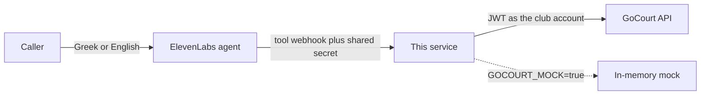

# GoCourt ElevenLabs agent

A small service that lets an [ElevenLabs](https://elevenlabs.io) voice agent book and cancel padel courts on GoCourt. It signs in as a club-owner (or staff) account and calls GoCourt's existing API. The GoCourt codebase is not modified.



The court clock is **Europe/Athens**, which is what GoCourt uses for "today", opening hours, and whether a slot has passed.

## What the caller can do

- Ask if a time is free. A taken slot comes back with the nearest free times. If several courts are free, one is booked without asking which.
- "Tomorrow evening" or "at 7" is not booked. The agent asks which hour, or whether they mean morning or evening.
- A booking is read back as the day, the time, and the name, then created only after a clear yes. The phone number is read back once, in grouped digits, as soon as they say it, and is not repeated after that. A court number or court type is mentioned only when the caller asks.
- A cancellation needs a booking number, or the name and phone. If more than one booking matches, the agent asks which one, then asks again before cancelling.

## How it talks to GoCourt

The service signs in as a club account and uses a bearer token for every later call. All GoCourt paths live in one module, `src/gocourt/routes.ts`. For each tool call it:

- reads the club's opening hours, booking rules, and pricing rules
- reads that day's courts and bookings to find free slots and the nearest alternatives
- creates a front-desk booking with the caller's name and phone
- searches the club's bookings and cancels one as the club

The token is cached on that process until shortly before it expires, then refreshed. A `401` triggers one fresh login. A new process (including a new Vercel instance) has no token and signs in on the next call. Each GoCourt HTTP call aborts after 25 seconds so a slow upstream does not hold the webhook open for the whole minute ElevenLabs allows.

Dates are `YYYY-MM-DD`. Times are `HH:MM` in Athens wall-clock time. A Greek mobile is stored by GoCourt as `694 123 4567`.

Availability for the phone desk is the owner schedule (every active court, inside opening hours), not the public online-slot grid. That grid hides hours the club only takes by phone.

## Setup

Use Node 22.

```bash
cp .env.example .env
npm install
npm test
npm run dev
```

Mock mode is the default in `.env.example` (`GOCOURT_MOCK=true`). It needs `TOOL_SHARED_SECRET` and does not call GoCourt. The demo club is "Demo Padel Club", open 08:00–23:00, with two courts. Tomorrow at 19:00 is already taken on both, so you can hear the alternatives.

## Environment

| Variable | Required | Purpose |
|---|---|---|
| `TOOL_SHARED_SECRET` | always | Secret ElevenLabs sends in `x-tool-secret` |
| `TOOL_SECRET_HEADER` | no | Header name, default `x-tool-secret` |
| `GOCOURT_MOCK` | no | `true` uses the in-memory club |
| `GOCOURT_API_BASE_URL` | live mode | GoCourt base URL **including** `/api`, for example `https://api.example.com/api` |
| `GOCOURT_REQUEST_TIMEOUT_MS` | no | Milliseconds for one GoCourt call. Default `25000` (allowed range 1000–50000) |
| `GOCOURT_OWNER_EMAIL` | live mode | Owner or staff email |
| `GOCOURT_OWNER_PASSWORD` | live mode | That account's password |
| `GOCOURT_LOGIN_HEADERS` | no | JSON object of extra headers sent with the login request only |
| `GOCOURT_OWNER_TOKEN` | no | Bearer token instead of a password, until it expires |
| `GOCOURT_CLUB_ID` | no | Which club, when the account has more than one |
| `GOCOURT_TIMEZONE` | no | Default `Europe/Athens` |
| `PORT` | no | Default `8787` |
| `TOOL_PUBLIC_BASE_URL` | for ElevenLabs | Public origin of this service, no trailing slash |
| `ELEVENLABS_API_KEY` | upsert script | Not read by the booking server |
| `ELEVENLABS_AGENT_ID` | demo page | Widget on `/` |
| `ELEVENLABS_TOOL_SECRET_ID` | upsert script | Workspace secret **id** whose value is `TOOL_SHARED_SECRET` |

Nothing secret belongs in the repo. `.env` is gitignored. `.env.example` has placeholders only.

Live mode refuses to start without an API base URL and either a token or an email and password.

## Run it locally

```bash
npm run dev
```

`GET /health` returns `{ "status": "ok", "mock": true }`.

Tool routes (all `POST`, header `x-tool-secret`):

- `/tools/check_availability`
- `/tools/create_booking`
- `/tools/find_booking`
- `/tools/cancel_booking`

`GET /` is a one-page demo. With `ELEVENLABS_AGENT_ID` set, Call starts a voice conversation and Chat opens a text-only chat with that agent. The widget talks to ElevenLabs; ElevenLabs calls the tool routes.

Check tomorrow at 7 in the evening (taken in the mock) and an earlier hour (free):

```bash
curl -s -H "Content-Type: application/json" -H "x-tool-secret: $TOOL_SHARED_SECRET" \
  -d '{"date":"tomorrow","time":"19:00"}' \
  http://localhost:8787/tools/check_availability

curl -s -H "Content-Type: application/json" -H "x-tool-secret: $TOOL_SHARED_SECRET" \
  -d '{"date":"tomorrow","time":"18:00","customer_name":"Eleni Costa","customer_phone":"694 123 4567"}' \
  http://localhost:8787/tools/create_booking
```

The second call asks you to confirm and does not book. Send the same body with `"confirmed": true` to book. Cancelling works the same way: find the booking, then call `cancel_booking` with `"confirmed": true`.

## Let ElevenLabs reach it

ElevenLabs calls your server from the internet. Hosted, that server is the Vercel deployment below. On a laptop, open a tunnel instead:

```bash
ngrok http 8787
```

Put the https origin in `TOOL_PUBLIC_BASE_URL` (no path, no trailing slash). Point each webhook at `https://<that-host>/tools/<tool-name>` and send `x-tool-secret`. The agent definition, Greek and English lines, and the tool bodies are in [docs/elevenlabs-agent.md](docs/elevenlabs-agent.md) and [docs/agent-config.json](docs/agent-config.json).

```bash
npm run agent:upsert
```

creates or updates the agent. It does not deploy this service.

## Deploy on Vercel

`api/index.ts` wraps the same Express app `npm run dev` runs. `vercel.json` sends every path to that function, allows it 60 seconds, and includes the demo page template. Framework detection is off so Vercel does not treat `src/index.ts` (the local listener) as the deployment. `/health`, `/`, and the four `/tools/*` routes are the ones that matter. Tool routes still require the shared-secret header. `/health` and `/` do not.

The GoCourt JWT lives in the function instance. A warm instance reuses it. A new instance signs in on the first tool call that needs it. Each upstream call stops at 25 seconds, and the function itself stops at 60.

1. Open [vercel.com/new](https://vercel.com/new) and import this GitHub repository.
2. Set the framework preset to **Other**. Leave the root directory as the repository root. Clear the build command and the output directory if Vercel fills them in. There is no start command. Vercel compiles `api/index.ts` on its own. Install stays `npm install`.
3. Add these environment variables for Production (and Preview, if preview URLs should book too). Do not commit the values.

| Name | What to put |
|---|---|
| `TOOL_SHARED_SECRET` | A long random string. The same value goes in the ElevenLabs workspace secret. |
| `GOCOURT_MOCK` | `false` |
| `GOCOURT_API_BASE_URL` | The GoCourt API base, for example `https://api.example.com/api` |
| `GOCOURT_LOGIN_HEADERS` | Optional. Extra login headers as JSON, if your GoCourt deployment needs them. |
| `GOCOURT_OWNER_EMAIL` | The club account |
| `GOCOURT_OWNER_PASSWORD` | That account's password |
| `GOCOURT_CLUB_ID` | Only if that account can see more than one club |
| `GOCOURT_TIMEZONE` | `Europe/Athens` (optional; this is the default) |
| `GOCOURT_REQUEST_TIMEOUT_MS` | `25000` (optional; this is the default) |
| `ELEVENLABS_AGENT_ID` | Optional, and only after the upsert below. It fills the widget on `/`. |
| `TOOL_SECRET_HEADER` | Optional. Default `x-tool-secret`. |

Leave `ELEVENLABS_API_KEY` and `ELEVENLABS_TOOL_SECRET_ID` off Vercel. The upsert script reads them on your machine. `TOOL_PUBLIC_BASE_URL` is not read by the function; set it locally in the next step.

4. Deploy.
5. Copy the deployment origin, for example `https://gocourt-elevenlabs-agent.vercel.app`. No path and no trailing slash.
6. In the local `.env`, set `TOOL_PUBLIC_BASE_URL` to that origin.
7. Run `npm run agent:upsert`. That registers `https://<that-host>/tools/check_availability` (and the other three tools) and the `x-tool-secret` header.
8. Open `https://<that-host>/health`. A live deploy returns `{ "status": "ok", "mock": false }`.

`npm run dev` is unchanged and still listens on port 8787.

## Demo

A recorded demo is coming soon.

## Try it yourself, about two minutes

Start with `GOCOURT_MOCK=true`, the widget or the ElevenLabs test call, and speak Greek. Then one line in English to show the switch.

1. "Θέλω γήπεδο αύριο το βράδυ." The agent asks for an hour. It does not guess.
2. "Στις επτά." The agent asks morning or evening.
3. "Το βράδυ." That time is taken. It offers six and eight.
4. "Στις έξι, για την Ελένη Κώστα, 694 123 4567." It reads the number back once, in grouped digits. The booking confirmation then reads the time and the name, and does not repeat the number or a court.
5. "Ναι." It gives a booking number.
6. "Ακύρωσε την κράτηση του Νίκου." Two bookings match. It asks which number.
7. Give one number, agree to cancel, and it confirms the cancellation.
8. In English: "Is anything free tomorrow at six?" It answers in English.

## Tests

```bash
npm test
npm run typecheck
```

The tests call the tool handlers against the in-memory club, check the shared-secret header, and check that the HTTP client logs in once and posts `POST /bookings/manual` with the field names GoCourt expects.

## Going live

1. Create a GoCourt staff login used only by this service, with access to bookings. Prefer that over the owner's personal password.
2. Set `GOCOURT_MOCK=false`, `GOCOURT_API_BASE_URL` (the same `…/api` base the GoCourt website uses), and the staff email and password. Set `GOCOURT_CLUB_ID` if that account can see more than one club.
3. Put a long random `TOOL_SHARED_SECRET` here and in an ElevenLabs workspace secret. Put the secret **id** in `ELEVENLABS_TOOL_SECRET_ID`.
4. Deploy on Vercel as above (or use ngrok for a laptop trial). Set `TOOL_PUBLIC_BASE_URL` to that https origin.
5. Run `npm run agent:upsert`, or paste `docs/agent-config.json` and replace the two placeholders. Choose a Greek-capable voice.
6. Call the agent and book a slot you can cancel. Confirm the booking appears in the GoCourt owner schedule, then cancel it from the call.
7. If login returns "Password change required", change the password in GoCourt first. The API blocks every other call until that is done.

This repository does not change GoCourt. Vercel builds it when you import the repo; nothing here merges or deploys on its own.

## License

MIT. See [LICENSE](LICENSE).
